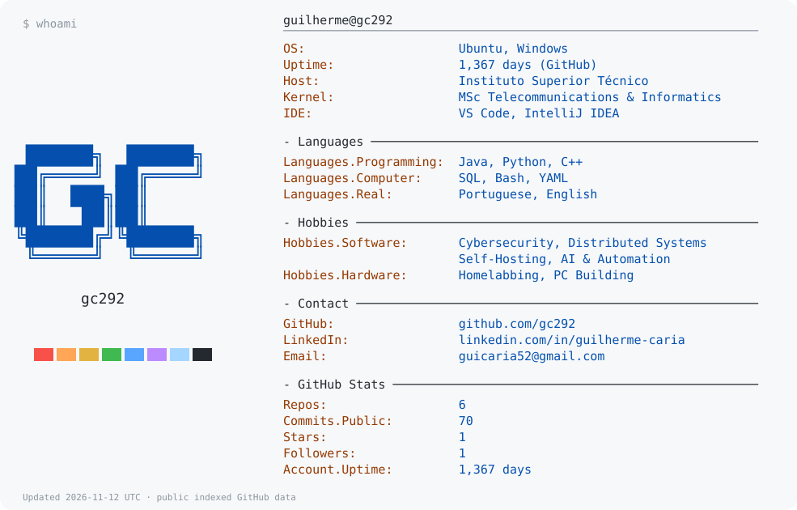

<picture>
  <source media="(max-width: 650px) and (prefers-color-scheme: dark)" srcset="https://raw.githubusercontent.com/gc292/gc292/main/dark_mode_compact.svg?v=77bcb5ad6799">
  <source media="(max-width: 650px)" srcset="https://raw.githubusercontent.com/gc292/gc292/main/light_mode_compact.svg?v=08b03ae5f4f8">
  <source media="(prefers-color-scheme: dark)" srcset="https://raw.githubusercontent.com/gc292/gc292/main/dark_mode.svg?v=ec5a30e82c5b">
  
</picture>

  <a href="https://github.com/gc292">GitHub</a> ·
  <a href="https://www.linkedin.com/in/guilherme-caria/">LinkedIn</a> ·
  <a href="mailto:guicaria52@gmail.com">Email</a>

