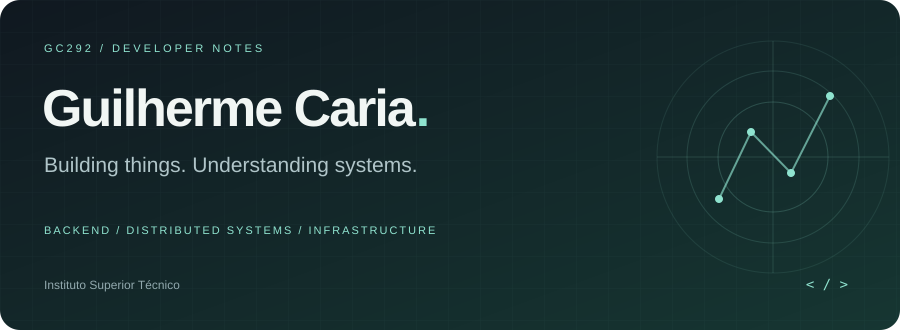
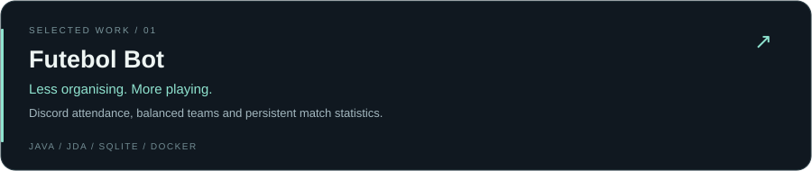
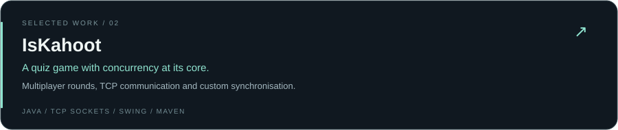
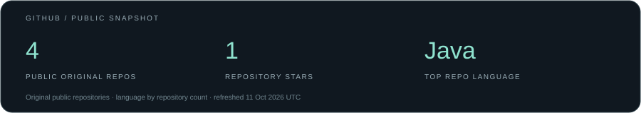

<p align="center">
  
</p>

<p align="center">
  <a href="https://github.com/gc292?tab=repositories"></a>
  <a href="https://tecnico.ulisboa.pt/en/"></a>
</p>

### A little about me

Hey, I'm **Guilherme** — a student at **Instituto Superior Técnico** with an interest in backend development, distributed systems and the infrastructure that keeps them running.

I enjoy taking an idea all the way to something useful: from multiplayer games and Discord bots to exploring concurrency, persistence and deployment.

```java
while (curious) {
    build();
    breakThings();
    understandWhy();
    improve();
}
```

### My toolkit

<p>
  
  
  
  
  <br />
  
  
  
  
</p>

### Things I've built

<a href="https://github.com/gc292/futebol-bot"></a>

<a href="https://github.com/gc292/IsKahoot"></a>

<p align="right"><a href="https://github.com/gc292?tab=repositories">More repositories ↗</a></p>

### Around here



<p align="center"><sub>Always curious about what happens under the hood.</sub></p>
